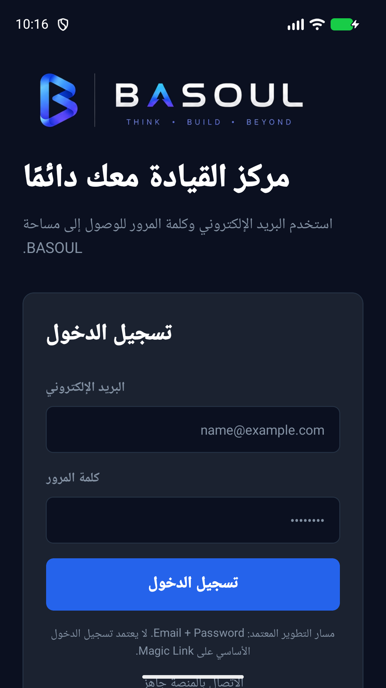

# BASOUL Android v4.0.0 (Build 32) — release candidate notes

> **Release status:** EAS FINISHED, SHA-256 and APK signature verified, emulator installation and cold launch PASS. Authenticated journeys and physical-device testing remain NOT TESTED. Prepare a Draft Release, not a newly verified production-stable mobile release.

## Verified Android artifact

- Version: `4.0.0`; Android versionCode: `32`; package: `com.yosseufradwan.os`
- Expo SDK: `57.0.0`; EAS profile: `preview` (internal distribution APK)
- Git commit: `18219ccf4fa67d1b6be830b9ffdec99d835431f2`
- EAS build ID: `ff4b3398-404f-4151-9484-3be0c8ddbb6d`
- Build page: https://expo.dev/accounts/yosseufs-team/projects/yosseuf-os/builds/ff4b3398-404f-4151-9484-3be0c8ddbb6d
- Local artifact filename supplied for release upload: `application-ff4b3398-404f-4151-9484-3be0c8ddbb6d.apk`
- Artifact SHA-256: `b7988e469fa7cab82f3c3f2d496041c258fd9f29c08285940c115a8fb5c806a7`
- Artifact ZIP integrity: checked; no compressed-data errors.
- EAS API/CLI verification: `FINISHED`, `ANDROID`, `INTERNAL`, profile `preview`, SDK `57.0.0`, exact source commit above; Expo artifact expiration `2026-11-10T13:25:00.625Z` (valid at verification on 2026-10-27).
- Actual binary metadata (`aapt`): package `com.yosseufradwan.os`, versionName `4.0.0`, versionCode `32`, min SDK `24`, target/compile SDK `36`.
- APK Signature Scheme v2 verification PASS; RSA 2048 signer certificate SHA-256 `7540b24f6840365933b712c6e61ff0cbd6f6963208d64c62b2b305a118fb1aac`. Signature validity does not prove compatibility with a previously installed signing certificate.
- Actual emulator validation: `adb install` returned `Success`; `am start -W` cold launch returned `Status: ok` (1617 ms); package-manager readback confirmed versionCode 32. Initial emulator boot showed a System UI ANR; it cleared, and the subsequent app cold launch succeeded. This does not establish long-running stability or authenticated journeys.

## Actual screenshot

Captured from the exact verified APK on the Pixel_10 emulator, without account credentials or customer data. Dashboard and authenticated screenshots are unavailable and are not substituted with historical imagery.

## Android build changes

- Fixed the `node-forge` postinstall security patch so a repeated EAS prebuild install does not fail when the reviewed patch is already applied.
- Added a regression test for repeated patch execution.
- Updated the mobile production security audit's expected advisory package reporting.
- Quality Gate and Mobile Runtime Validation checks passed for the fix before merge.

## Product scope

BASOUL mobile currently documents authentication and session persistence, dashboard data, projects, notifications, refresh, and sign-out. Do not imply that every web/Architecture workspace feature is available in this Android APK without device verification.

## Release publication checklist

- [x] EAS build status: FINISHED, verified with authenticated EAS CLI
- [x] APK supplied and ZIP integrity / SHA-256 checked
- [x] Install exact APK on emulator and verify cold launch and package identity
- [x] Capture fresh login screenshot from this exact build
- [ ] Physical-device validation and authenticated sign-in, dashboard, projects, notifications, sign-out
- [ ] Upload APK as a **GitHub Release binary asset**; do not commit a 67 MB APK to Git
- [ ] Create a new GitHub Release tag only after checking existing tags and release history
- [ ] Verify GitHub Release asset downloads and checksum after publishing

## Screenshot policy

The README's historical `docs/assets/screenshots/executive-dashboard-v1.0.0.png` must not be presented as a current Android 4.0.0 screenshot. New screenshots must be captured from the current application and reviewed before replacing existing release imagery.
